<div align="center">


# HIDUSBF

**USB polling-rate overclocking for mice, keyboards and controllers, plus PlayStation controller calibration, a virtual controller and lighting.**

<a id="gallery"></a>

<table>
<tr>
<td width="50%" valign="top">
<a href="#overview">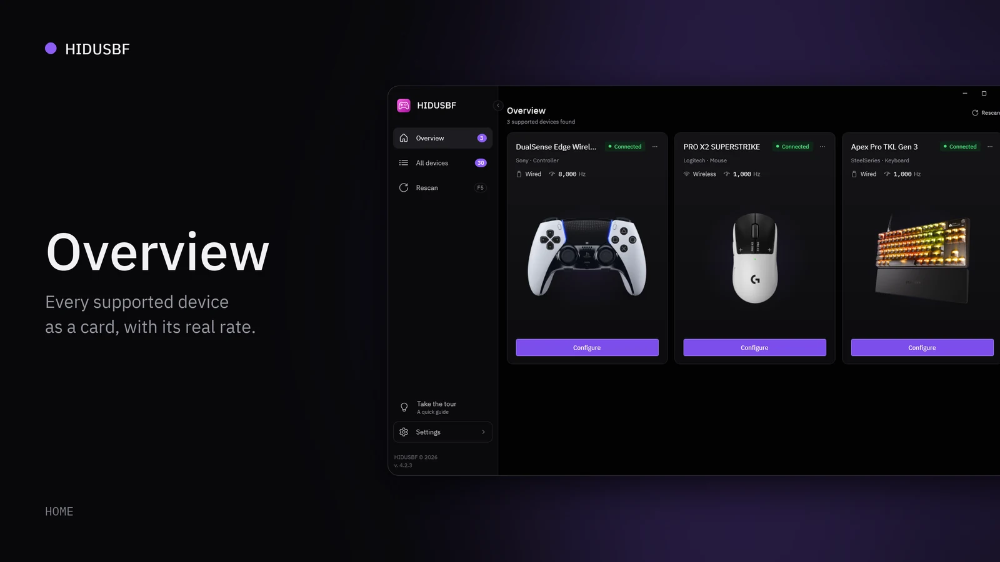</a>
<br/><a href="#overview"><strong>Overview</strong></a>
<br/><sub>Home</sub>
</td>
<td width="50%" valign="top">
<a href="#all-devices">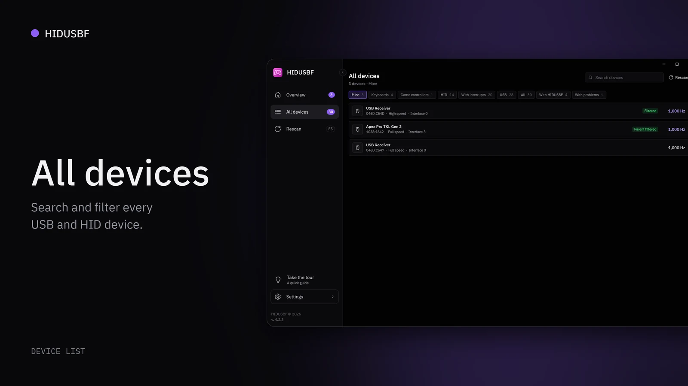</a>
<br/><a href="#all-devices"><strong>All devices</strong></a>
<br/><sub>Device list</sub>
</td>
</tr>
<tr>
<td width="50%" valign="top">
<a href="#input-and-polling-rate">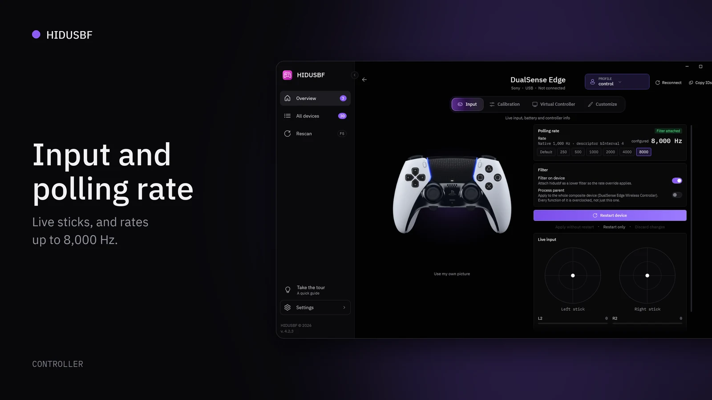</a>
<br/><a href="#input-and-polling-rate"><strong>Input and polling rate</strong></a>
<br/><sub>Controller</sub>
</td>
<td width="50%" valign="top">
<a href="#calibration">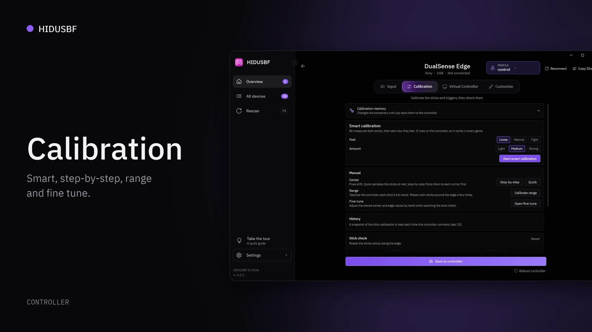</a>
<br/><a href="#calibration"><strong>Calibration</strong></a>
<br/><sub>Controller</sub>
</td>
</tr>
<tr>
<td width="50%" valign="top">
<a href="#virtual-controller">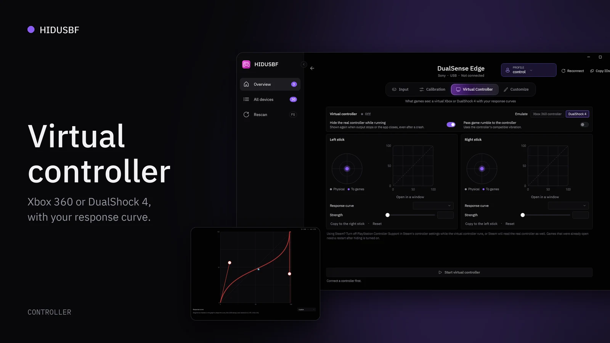</a>
<br/><a href="#virtual-controller"><strong>Virtual controller</strong></a>
<br/><sub>Controller</sub>
</td>
<td width="50%" valign="top">
<a href="#customize">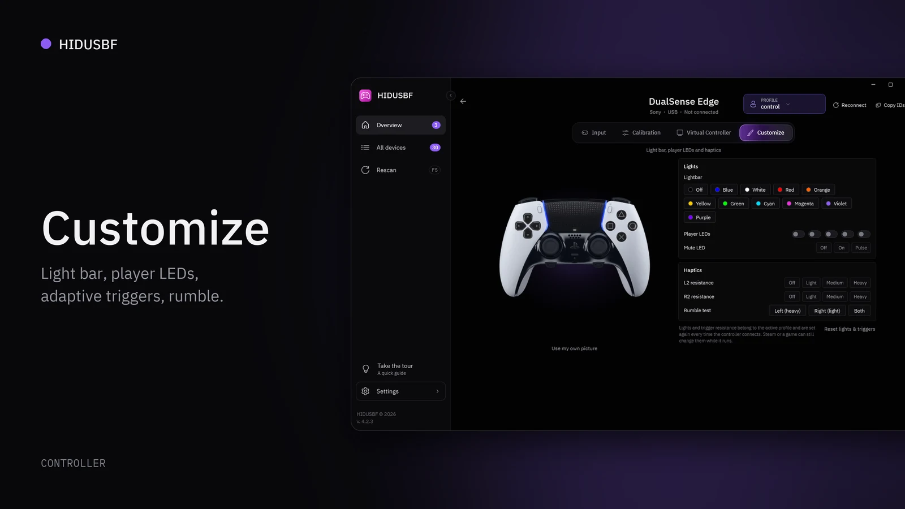</a>
<br/><a href="#customize"><strong>Customize</strong></a>
<br/><sub>Lights and haptics</sub>
</td>
</tr>
<tr>
<td width="50%" valign="top">
<a href="#mice">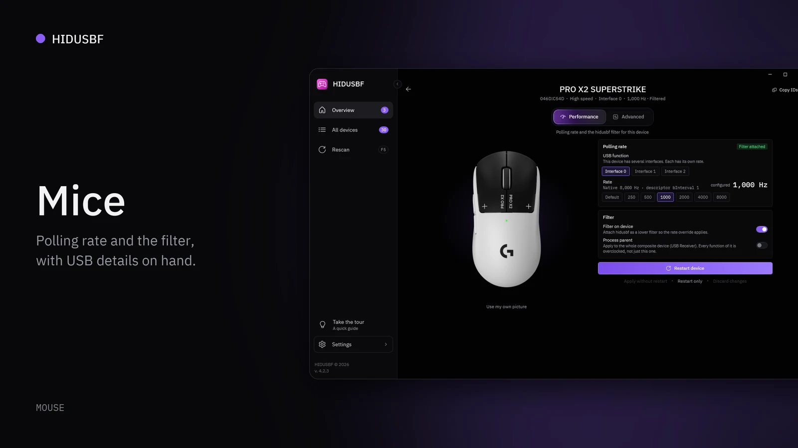</a>
<br/><a href="#mice"><strong>Mice</strong></a>
<br/><sub>Mouse</sub>
</td>
<td width="50%" valign="top">
<a href="#keyboards">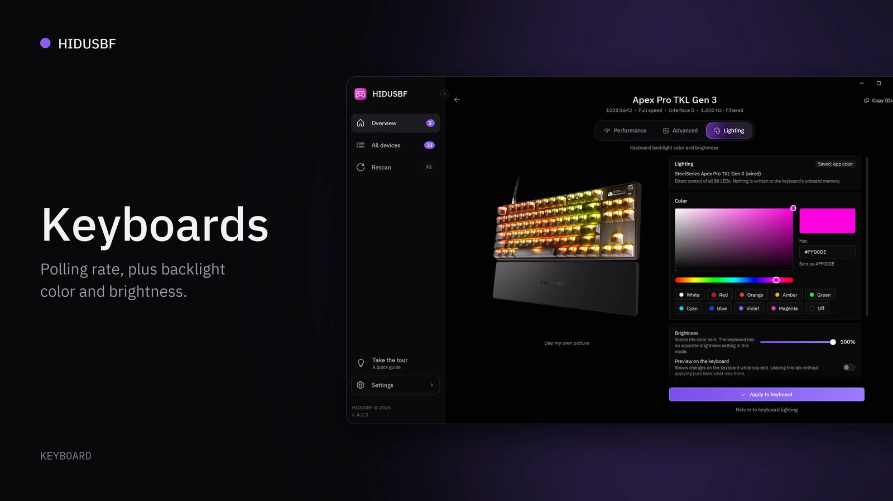</a>
<br/><a href="#keyboards"><strong>Keyboards</strong></a>
<br/><sub>Keyboard</sub>
</td>
</tr>
<tr>
<td width="50%" valign="top">
<a href="#settings">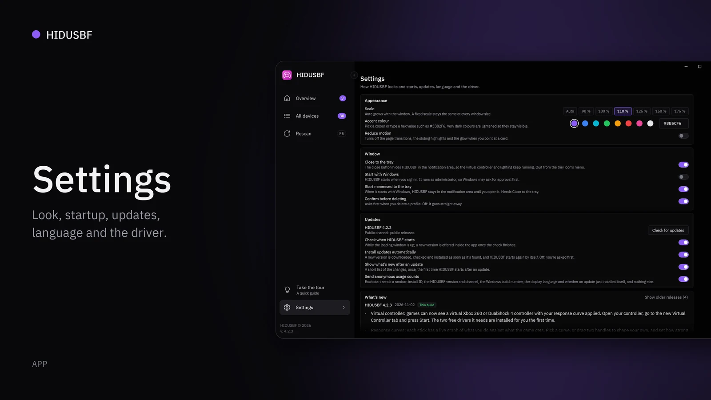</a>
<br/><a href="#settings"><strong>Settings</strong></a>
<br/><sub>App</sub>
</td>
<td width="50%" valign="top">
<a href="#welcome-and-tour">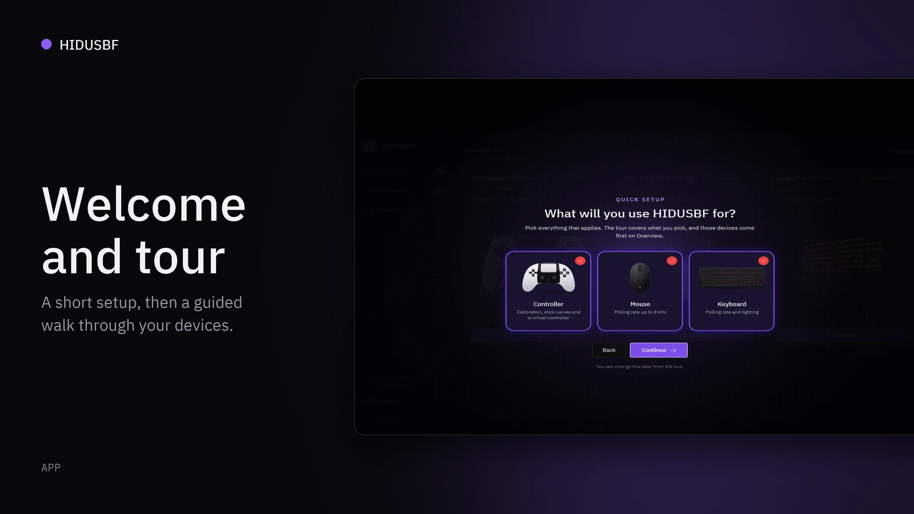</a>
<br/><a href="#welcome-and-tour"><strong>Welcome and tour</strong></a>
<br/><sub>First start</sub>
</td>
</tr>
</table>

[](https://github.com/KazboXIII/HIDUSBF-PUB/releases/latest)
[](https://github.com/KazboXIII/HIDUSBF-PUB/releases/latest)
[](#requirements)
[](https://hidusbf.app/)

**[Download the latest installer](https://github.com/KazboXIII/HIDUSBF-PUB/releases/latest)** · [Website](https://hidusbf.app/) · [Controller guide](https://hidusbf.app/information/) · [Report a problem](https://github.com/KazboXIII/HIDUSBF-PUB/issues)

</div>

---

## Table of contents

| Devices | Controller and app | Get it |
|---|---|---|
| [Overview](#overview)<br>[All devices](#all-devices)<br>[Input and polling rate](#input-and-polling-rate)<br>[Calibration](#calibration)<br>[Virtual controller](#virtual-controller) | [Customize](#customize)<br>[Mice](#mice)<br>[Keyboards](#keyboards)<br>[Settings](#settings)<br>[Welcome and tour](#welcome-and-tour) | [Install](#install)<br>[Requirements](#requirements)<br>[Good to know](#good-to-know)<br>[Credits](#credits)<br>[Website notes](#website-notes) |

---

## What's in it

### Overview


**Category:** Home  
**Best for:** Seeing your controller, mouse and keyboard at a glance.

The first page lists every supported device as a card, with its real name and picture where HIDUSBF can find one, how it connects and its current polling rate. **Configure** opens the device.

Highlights:

- Devices you picked during setup come first.
- Wired or wireless, and the rate, on each card.
- **Use my own picture** on any device, from the card's menu or its page.
- **F5** rescans. **Ctrl+B** collapses the sidebar to icons.

<table>
<tr>
<td align="center" width="25%" valign="top"><a href="./assets/readme/shots/overview.webp">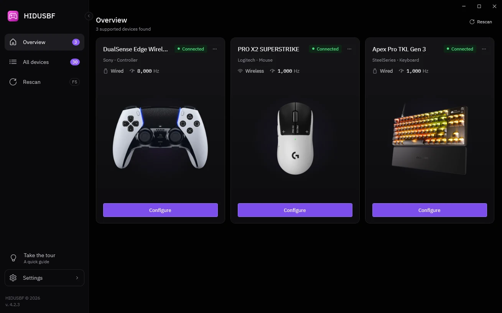</a><br /><sub><code>overview</code><br />device cards</sub></td>
<td align="center" width="25%" valign="top"><a href="./assets/readme/shots/menu-card.webp">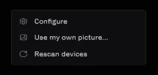</a><br /><sub><code>card menu</code><br />the ··· button</sub></td>
<td align="center" width="25%" valign="top"><a href="./assets/readme/shots/menu-tray.webp">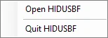</a><br /><sub><code>tray menu</code><br />reopen or quit</sub></td>
</tr>
</table>

---

### All devices


**Category:** Device list  
**Best for:** Finding a device that isn't on the Overview, or checking what is filtered.

Every device HIDUSBF can see, with its USB IDs, speed, interface and rate. Filter by type, or search.

Highlights:

- Filters for mice, keyboards, game controllers, HID, devices with interrupts, USB, and all devices.
- **With HIDUSBF** shows what has the filter on. **With problems** shows what needs a look.

<table>
<tr>
<td align="center" width="25%" valign="top"><a href="./assets/readme/shots/devices.webp">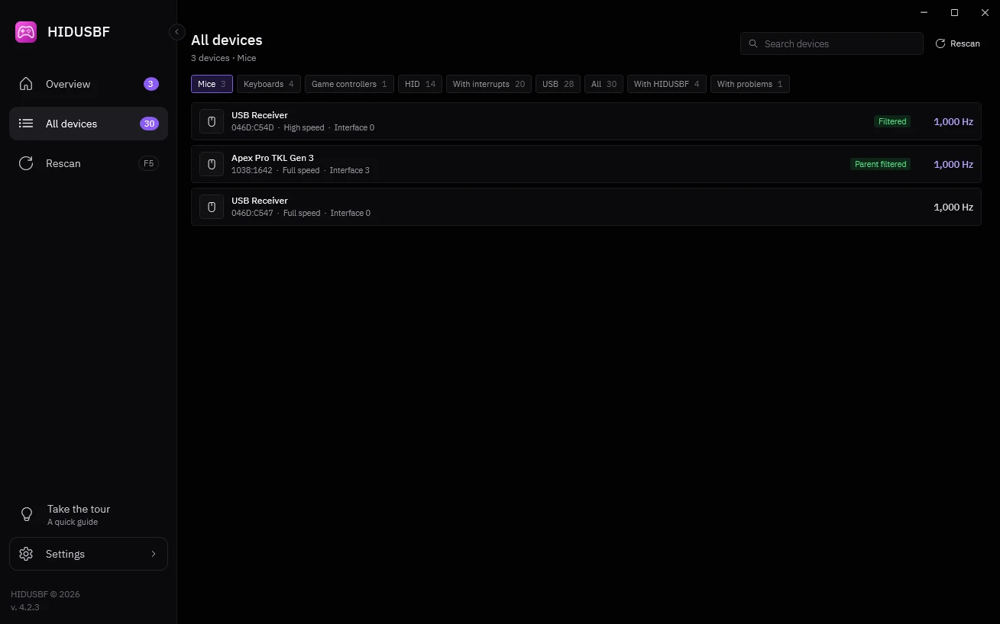</a><br /><sub><code>all devices</code><br />filters and search</sub></td>
</tr>
</table>

---

### Input and polling rate


**Category:** Controller  
**Best for:** Overclocking a controller and checking its sticks live.

A controller's first tab. Pick a rate, turn the filter on, and restart the device. Sony controllers on a USB cable also show the measured rate in reports per second, and warn when it falls short of the setting.

Highlights:

- Rates from 250 to 8,000 Hz, and a default option.
- Filter on device and Process parent switches.
- Live stick positions, triggers and every button.
- **Profiles** at the top, for separate setups.

<table>
<tr>
<td align="center" width="25%" valign="top"><a href="./assets/readme/shots/open0.webp">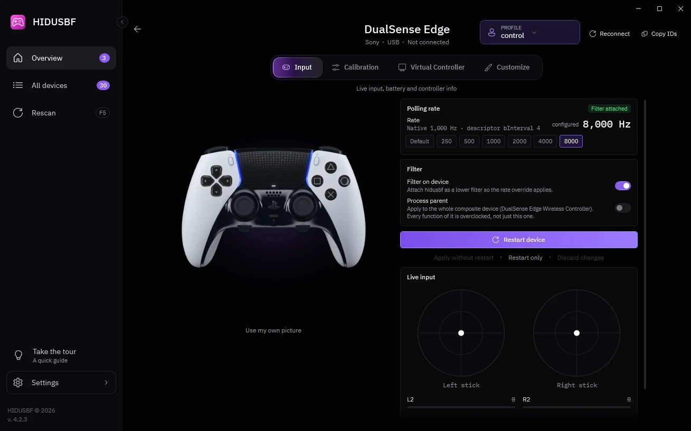</a><br /><sub><code>input</code><br />polling rate and live input</sub></td>
<td align="center" width="25%" valign="top"><a href="./assets/readme/shots/menu-profile.webp">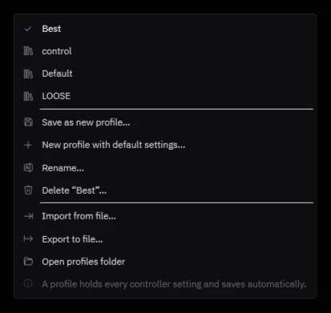</a><br /><sub><code>profiles</code><br />switch, save, import, export</sub></td>
</tr>
</table>

---

### Calibration


**Category:** Controller  
**Best for:** Fixing stick drift and uneven range on a PlayStation controller.

Calibrate the sticks and triggers, then check the result. Changes are temporary until you save them to the controller.

Highlights:

- **Smart calibration** measures both sticks, then asks how they feel.
- **Center**, step by step or quick. **Range**, by rotating the sticks. **Fine tune**, by adjusting the values directly.
- **History** keeps a snapshot before each calibration.
- **Stick check** to test the result.

<table>
<tr>
<td align="center" width="25%" valign="top"><a href="./assets/readme/shots/pad-calib.webp">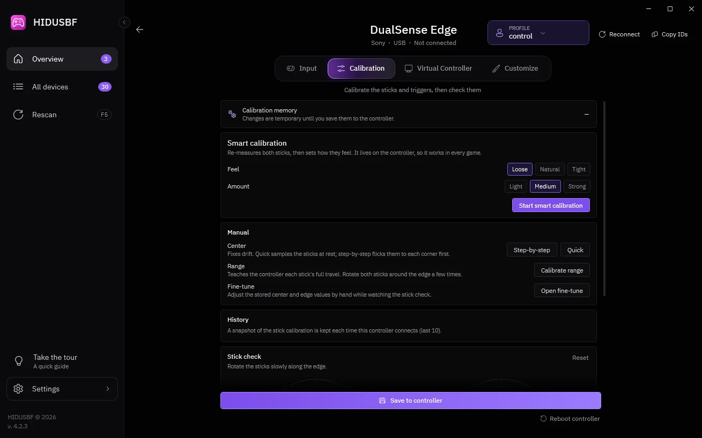</a><br /><sub><code>calibration</code><br />the whole tab</sub></td>
<td align="center" width="25%" valign="top"><a href="./assets/readme/shots/pad-wizard.webp">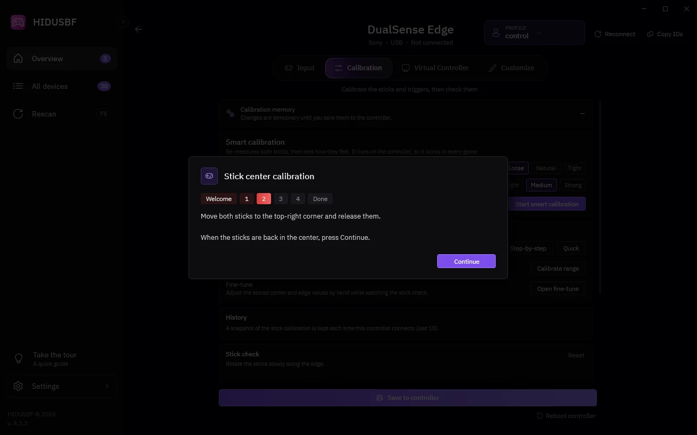</a><br /><sub><code>center</code><br />step-by-step wizard</sub></td>
<td align="center" width="25%" valign="top"><a href="./assets/readme/shots/pad-range.webp">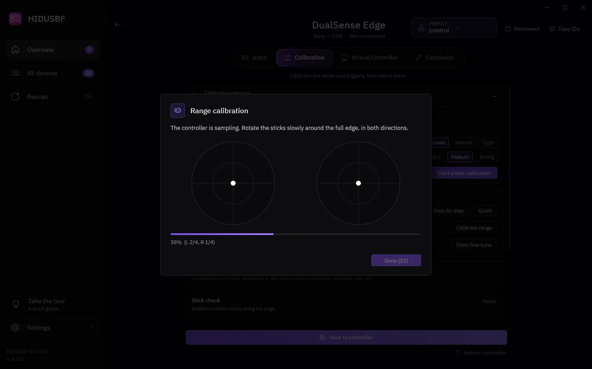</a><br /><sub><code>range</code><br />sampling the edges</sub></td>
</tr>
</table>

---

### Virtual controller


**Category:** Controller  
**Best for:** Playing with your own response curve in games that see a normal controller.

Games can see a virtual Xbox 360 or DualShock 4 controller with your response curve applied. Start and stop while playing: the game switches over in about half a second, and gets the real controller back when you stop.

Highlights:

- A live graph of what you do against what the game gets.
- Pick a curve or drag two handles to shape your own, and set how strong it is.
- **Open in a window** for a big, resizable editor.
- The two free drivers it needs, ViGEmBus and HidHide, install the first time. Each one is checked for a valid Nefarius signature before it runs.

<table>
<tr>
<td align="center" width="25%" valign="top"><a href="./assets/readme/shots/pad-output.webp">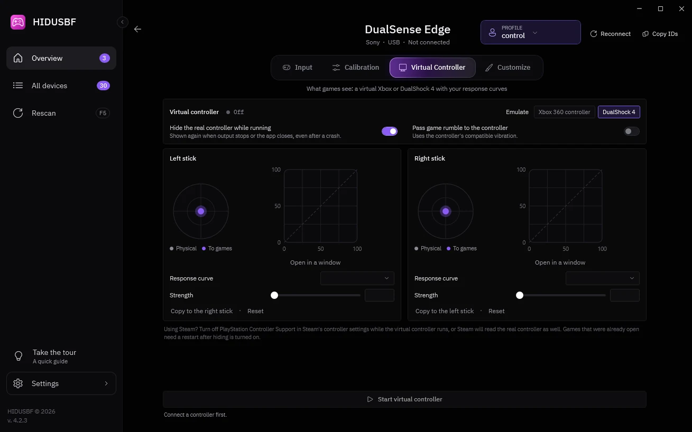</a><br /><sub><code>virtual controller</code><br />emulation and curves</sub></td>
<td align="center" width="25%" valign="top"><a href="./assets/readme/shots/curve.webp">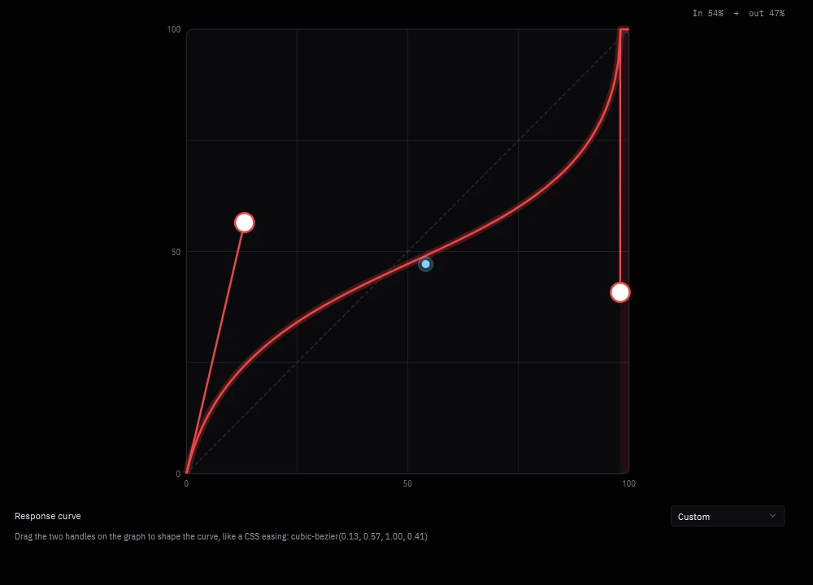</a><br /><sub><code>curve editor</code><br />the separate window</sub></td>
<td align="center" width="25%" valign="top"><a href="./assets/readme/shots/pad-install.webp">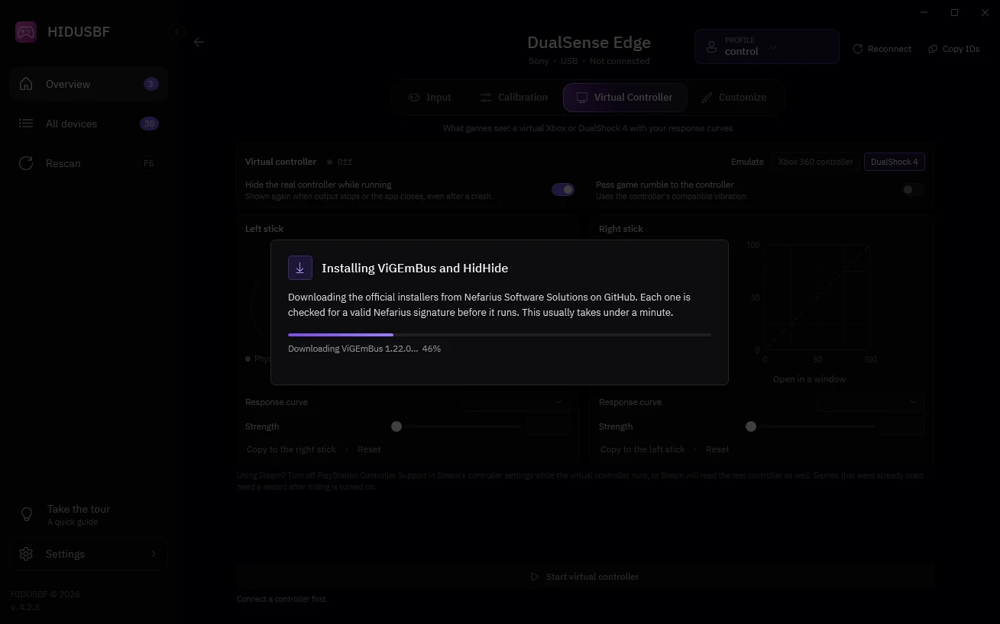</a><br /><sub><code>first start</code><br />installing the drivers</sub></td>
</tr>
</table>

---

### Customize


**Category:** Controller  
**Best for:** Setting your controller's lights and haptics.

Light bar color, player LEDs and the mute LED, plus trigger resistance and a rumble test. The light bar flashes green after a rate change, a restart, a calibration or a save, so you know it worked.

Highlights:

- Preset light bar colors, or off.
- L2 and R2 resistance from off to heavy.
- Reset lights and triggers in one click.

<table>
<tr>
<td align="center" width="25%" valign="top"><a href="./assets/readme/shots/pad-custom.webp">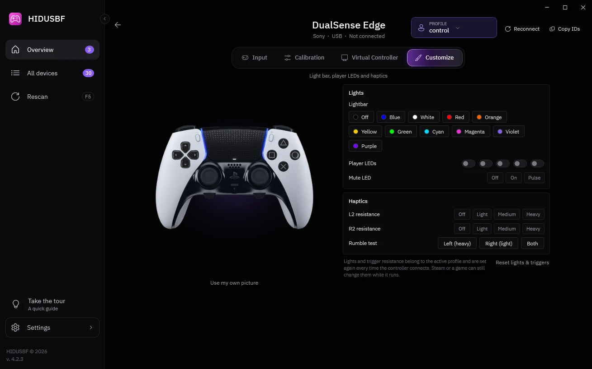</a><br /><sub><code>customize</code><br />lights and haptics</sub></td>
</tr>
</table>

---

### Mice


**Category:** Mouse  
**Best for:** Raising a mouse's polling rate, and getting details when something won't overclock.

**Performance** has the rate and the filter. **Advanced** lists the USB IDs and driver details, and **Copy IDs** puts them on the clipboard for a bug report. Logitech receivers are asked which mouse is paired, its name and its battery. HIDUSBF warns before a rate above what the device's USB speed class normally allows.

Highlights:

- Per-interface control on devices with several.
- HIDUSBF learns the fastest rate each controller model really reaches, and **Show every rate** turns that limit off.

<table>
<tr>
<td align="center" width="25%" valign="top"><a href="./assets/readme/shots/mouse-perf.webp">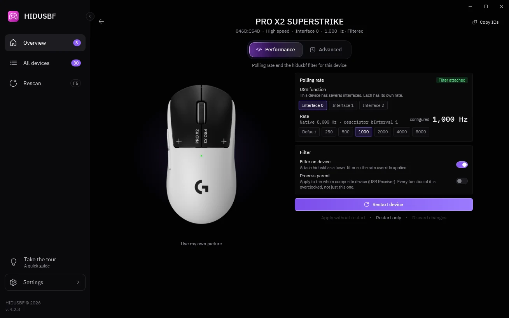</a><br /><sub><code>performance</code><br />rate and filter</sub></td>
<td align="center" width="25%" valign="top"><a href="./assets/readme/shots/mouse-adv.webp">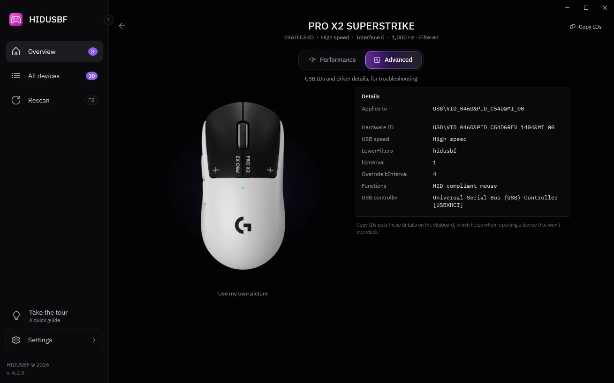</a><br /><sub><code>advanced</code><br />USB details, instance ID hidden here</sub></td>
<td align="center" width="25%" valign="top"><a href="./assets/readme/shots/warn.webp">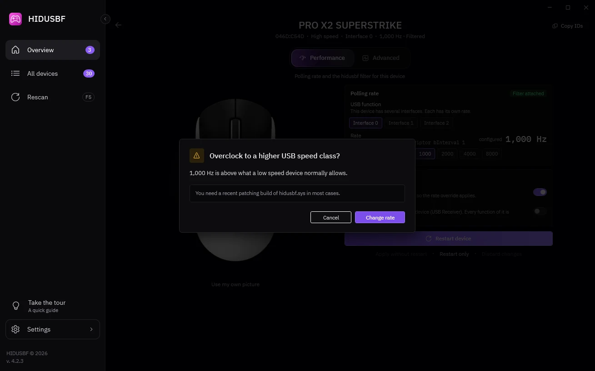</a><br /><sub><code>warning</code><br />before a higher speed class</sub></td>
</tr>
</table>

---

### Keyboards


**Category:** Keyboard  
**Best for:** Raising a keyboard's polling rate, and lighting supported keyboards.

The same **Performance** tab as a mouse. On a supported keyboard, **Lighting** adds backlight color and brightness, with a preview on the keyboard while you edit.

Highlights:

- A color square, a hue slider, a hex field and named presets.
- **Return to keyboard lighting** hands the lights back.

<table>
<tr>
<td align="center" width="25%" valign="top"><a href="./assets/readme/shots/kb-perf.webp">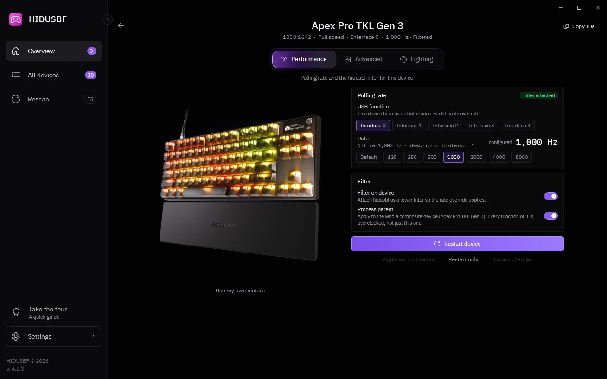</a><br /><sub><code>performance</code><br />rate and filter</sub></td>
<td align="center" width="25%" valign="top"><a href="./assets/readme/shots/kb-light.webp">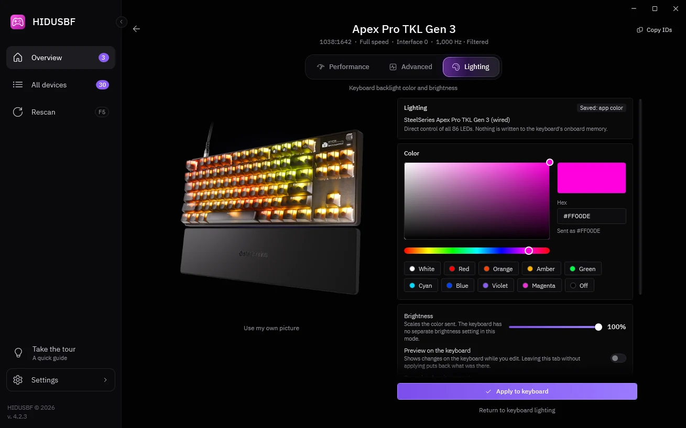</a><br /><sub><code>lighting</code><br />color and brightness</sub></td>
</tr>
</table>

---

### Settings


**Category:** App  
**Best for:** Changing how HIDUSBF looks and starts, and managing the driver.

One page, opened from the cog at the bottom of the sidebar. HIDUSBF installs SweetLow's hidusbf filter driver itself and switches its build to match the rates you choose, so there's nothing to do under **Driver** unless something is wrong.

Highlights:

- **Appearance:** scale from 90 % to 175 %, accent color, reduce motion.
- **Window:** close to the tray, start with Windows, start hidden.
- **Updates:** check at start, install automatically, what's new, usage counts.
- **Language**, **Driver** (status, reinstall, uninstall) and **Pictures**.

<table>
<tr>
<td align="center" width="25%" valign="top"><a href="./assets/readme/shots/settings-main.webp">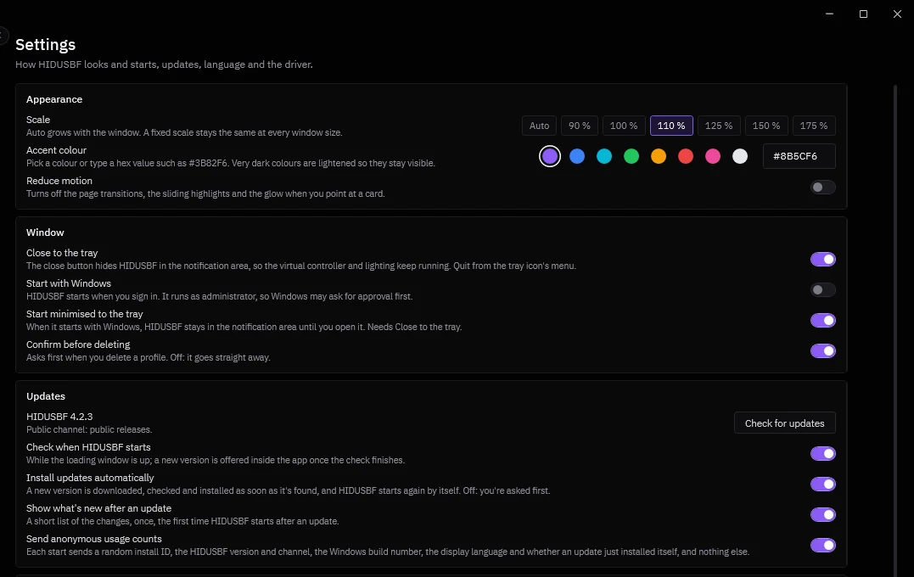</a><br /><sub><code>settings</code><br />look, window and updates</sub></td>
<td align="center" width="25%" valign="top"><a href="./assets/readme/shots/settings-driver.webp">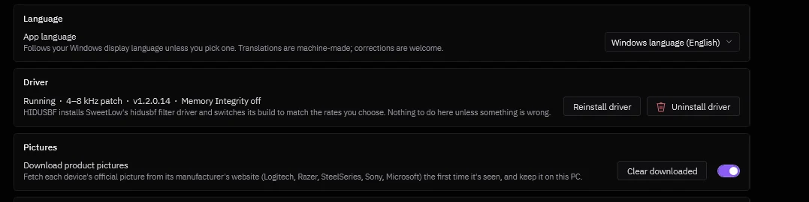</a><br /><sub><code>driver</code><br />language, driver and pictures</sub></td>
</tr>
</table>

---

### Welcome and tour


**Category:** App  
**Best for:** Getting started without reading anything.

The first start asks what you'll use HIDUSBF for, then offers a guided tour of the devices you picked. The tour only opens pages to show them and never changes a setting. Replay it any time with **Take the tour** in the sidebar.

Highlights:

- Whatever is plugged in is ticked already.
- Right arrow or Enter for next, left arrow for back, Esc to skip.
- After an update, **What's new** pops up once.

<table>
<tr>
<td align="center" width="25%" valign="top"><a href="./assets/readme/shots/welcome-uses.webp">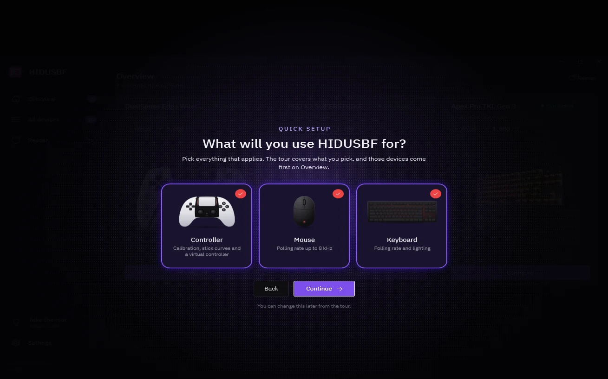</a><br /><sub><code>setup</code><br />what will you use it for</sub></td>
<td align="center" width="25%" valign="top"><a href="./assets/readme/shots/welcome-offer.webp">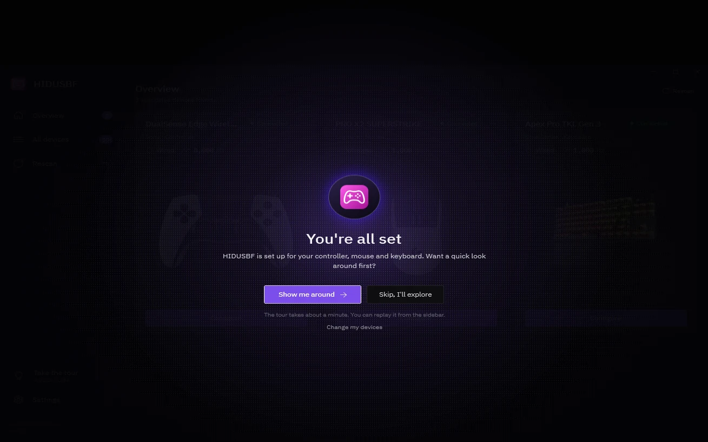</a><br /><sub><code>tour</code><br />the offer</sub></td>
<td align="center" width="25%" valign="top"><a href="./assets/readme/shots/whatsnew.webp">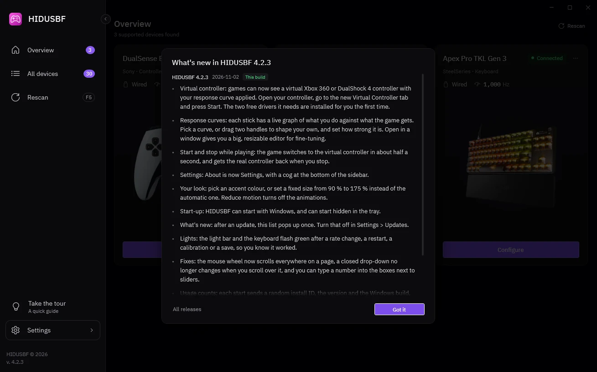</a><br /><sub><code>what's new</code><br />after an update</sub></td>
</tr>
</table>

---

## Install

| Step | What to do |
|---|---|
| 1 | Get the latest **HIDUSBF-x.y.z-Setup.exe** from [Releases](https://github.com/KazboXIII/HIDUSBF-PUB/releases/latest). |
| 2 | Run it. HIDUSBF installs to Program Files and adds a Start menu entry. |
| 3 | The installer isn't code-signed yet, so Windows SmartScreen may warn the first time. Choose **More info > Run anyway**. |

After that, HIDUSBF checks this page for new versions while its loading window is up and offers to install them. You can change that in **Settings > Updates**.

Each release has a `.sha256` file next to the installer, so you can check the download:

```powershell
Get-FileHash .\HIDUSBF-4.2.3-Setup.exe -Algorithm SHA256
```

## Requirements

| Needs | Details |
|---|---|
| Windows | 8.1 or later, 64-bit |
| Rights | Administrator, because it installs and manages the hidusbf filter driver |
| Virtual controller | ViGEmBus and HidHide, installed for you the first time |
| Keyboard lighting | A supported keyboard |

## Good to know

- Uninstalling HIDUSBF leaves the driver in place. Remove it first from **Settings > Driver > Uninstall driver** if you want it gone.
- Usage counts: each start sends a random install ID, the HIDUSBF version and channel, the Windows build number, the display language and whether an update just installed itself. Turn it off in **Settings > Updates**.
- Product pictures come from each manufacturer's website the first time a device is seen, and stay on your PC. Turn that off in **Settings > Pictures**.

## Credits

- [hidusbf](https://github.com/LordOfMice/hidusbf) filter driver by SweetLow.
- [ViGEmBus and HidHide](https://github.com/nefarius) by Nefarius Software Solutions.
- Product names and pictures belong to their owners.

## Website notes

<details>
<summary>How this repository's website is built</summary>

GitHub Pages serves this repository's `main` branch at https://hidusbf.app/.
The homepage's sections below the hero use `home.css` and `home.js`, so the shared `style.css` keeps serving the hero, the navigation and the other pages unchanged. The screenshots in `assets/app/` are real app captures.
The controller information guide lives in `information/index.html` and uses the shared stylesheet plus `information/information.css`. It requires no build step, JavaScript or third-party runtime dependency.

When updating the guide, check exact hardware/firmware revisions against the cited primary documentation, distinguish vendor claims from measurements, and update the research date only for a substantive source review. Keep inline source anchors, the source notes and homepage navigation working. The guide's polling chart shows calculated intervals, not latency measurements.

The private dashboard lives in `dashboard/` at https://hidusbf.app/dashboard/ and isn't linked from the site. Download numbers come straight from the GitHub API. Launch numbers come from the app's anonymous counter and need the stats key, which the page keeps in memory only: it is never stored here or in the browser. `node --test` runs the tests in `tests/` (Node 22 or newer, no packages needed).

</details>
